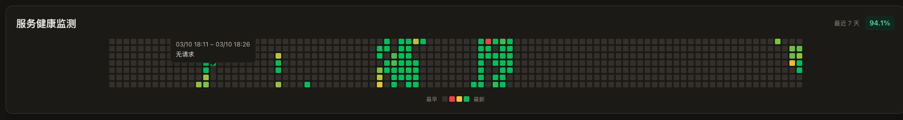
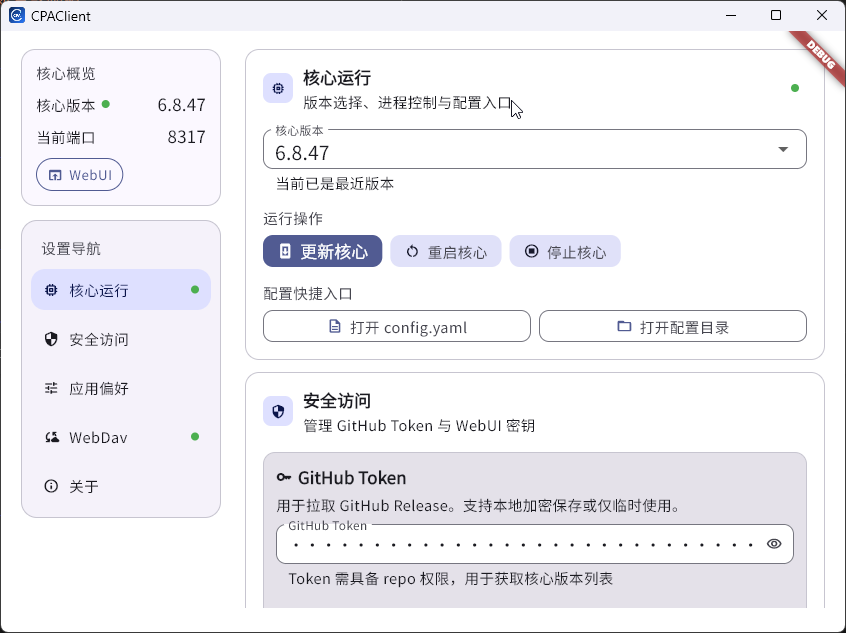

# CPAClient

[English](README.zh-CN.md)

CPAClient 是一个面向日常使用的桌面客户端，用于图形化管理并运行 [CLIProxyAPI](https://github.com/router-for-me/CLIProxyAPI)。

> 目标：把“下载核心 / 更新核心 / 管理配置 / WebDAV 同步 / 托盘常驻”做成开箱即用的桌面体验。

---

## 功能总览（重点）

### 核心管理
- ✅ 一键初始化运行环境（sandbox + config）
- ✅ 自动下载并启动核心
- ✅ 核心版本切换、更新、重启、停止
- ✅ 支持统计数据恢复，核心重启后统计数据不丢失

### 配置与同步
- ✅ WebDAV 连接测试
- ✅ 配置一键备份 / 一键恢复
- ✅ 自动备份（按时间间隔）
- ✅ 统计数据支持通过 WebDAV 多端同步

### 桌面体验
- ✅ 托盘常驻（设置 / 停止核心 / 退出）
- ✅ 关闭窗口行为可配置：
  - 最小化到托盘
  - 直接退出（先停核心，避免残留进程）
- ✅ 开机自启动
- ✅ 主题切换（浅色 / 深色 / 跟随系统）

### 快捷入口
- ✅ 一键打开 WebUI
- ✅ 一键打开 `config.yaml`
- ✅ 一键打开配置目录和 sandbox 目录

---

## 界面截图

### 数据保存


### 日间模式


### 夜间模式


---

## 使用者快速上手

### 1. 下载
从 Releases 下载对应系统版本：
- https://github.com/AriaLyy/CPAClient/releases

### 2. 启动
首次启动会自动执行核心准备流程（初始化、下载、启动）。

### 3. 建议先配置
- GitHub Token（避免下载限流）
- WebUI 密钥
- WebDAV 信息（如需备份/同步）
- 关闭窗口行为（托盘最小化或直接退出）

---

## 推荐使用方式

- **日常**：关闭窗口 -> 最小化到托盘，后台持续可用
- **彻底退出**：托盘点“退出”或设置“关闭窗口直接退出”
- 退出前会先停止核心，避免后台残留

---

## 常见问题

### 下载核心时报 403
请先配置 GitHub Token。

### WebUI 打不开
确认核心是否运行、端口是否正确；查看 `sandbox/app.log`。

### WebDAV 失败
先测试连接，再检查 URL/账号/密码（URL 需 `https://` 且不要以 `/` 结尾）。

---

## 支持平台

- Windows: `amd64`、`arm64`
- macOS: `amd64`、`arm64`
- Linux: `amd64`、`arm64`

---

## 开发者（可选）

```bash
flutter pub get
flutter run -d windows
# 或 macos / linux
```

本地打包：

```bash
python3 tool/package_local.py
```

---

## 相关项目
- CLIProxyAPI: https://github.com/router-for-me/CLIProxyAPI
- CPAClient: https://github.com/AriaLyy/CPAClient

## 协议
GPL-3.0，详见 [LICENSE](LICENSE)。
