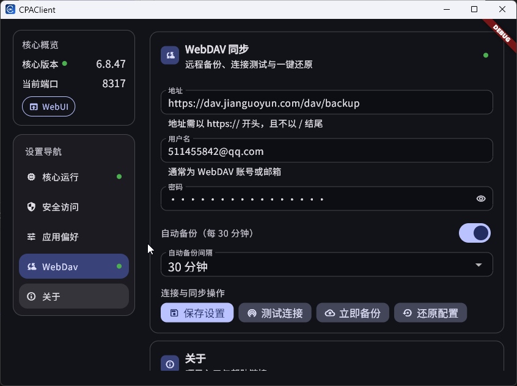

# CPAClient

[简体中文](README.zh-CN.md)

CPAClient is a Flutter desktop client that manages and runs [CLIProxyAPI](https://github.com/router-for-me/CLIProxyAPI) locally.
It provides a settings-first experience for downloading/updating the core binary, managing WebUI access, and synchronizing `config.yaml` via WebDAV.

## Features

### Feature List

- Supports statistics data backup, and stats remain after core restarts
- Supports multi-device data sync via WebDAV
- Supports core updates
- Supports quick access to WebUI

- **One-click core bootstrap**
  - Initializes sandbox directories and `config.yaml`
  - Downloads the correct CLIProxyAPI release asset by OS/arch
  - Starts the core process automatically
- **Core management UI**
  - Select recent core versions from GitHub releases
  - Update/restart core
  - Open WebUI directly (`http://127.0.0.1:<port>/management.html#/login`)
  - Quick-open `config.yaml`, config directory, and sandbox directory
- **Security & access settings**
  - Save GitHub token (for release API access / rate-limit avoidance)
  - Save WebUI password (`remote-management.secret-key`)
- **WebDAV sync**
  - Save WebDAV endpoint/credentials
  - Test connection
  - Backup and restore `config.yaml`
  - Visual sync status (idle/running/success/failure)
- **Desktop integration**
  - Tray menu: WebUI / Settings / Exit
  - Launch at startup toggle
  - Light / Dark / System theme

## Screenshots

### Light Mode


### Dark Mode



## Supported Platforms

Runtime support follows Flutter desktop targets and the bundled core binary format.
Current release workflow builds:

- Linux: `amd64`, `arm64`
- macOS: `amd64`, `arm64`
- Windows: `amd64`, `arm64`

## Quick Start (Development)

### 1) Prerequisites

- Flutter SDK (project currently uses stable `3.35.5` in CI)
- Dart SDK compatible with `sdk: ^3.6.2`
- Platform-specific desktop toolchain:
  - **Windows**: Visual Studio C++ desktop workload
  - **macOS**: Xcode command line tools
  - **Linux**: `clang`, `cmake`, `ninja-build`, `pkg-config`, `libgtk-3-dev`, and appindicator dev package

### 2) Install dependencies

```bash
flutter pub get
```

### 3) Run desktop app

```bash
flutter run -d windows
# or
flutter run -d macos
# or
flutter run -d linux
```

## Backup Data

- WebDAV backup/restore currently covers: `sandbox/config/config.yaml`.
- In the **WebDAV** section of Settings, you can:
  - Test connection
  - Run manual backup
  - Restore a selected backup version
  - Enable automatic backup (minute-based interval)
- Backup version history includes timestamps so you can pick a specific restore point.
- It is recommended to run connection test successfully before backup/restore.

## Build & Release

Tag-based release pipeline is defined in `.github/workflows/release.yml`:

- Trigger: push tag matching `v*`
- Matrix build across Linux/macOS/Windows and amd64/arm64 variants
- Packages artifacts (`.tar.gz` for Linux/macOS, direct `.exe` for Windows)
- Uploads assets to GitHub Release for the tag

## Local Packaging

Use the Python script to package on the current host OS:

```bash
python3 tool/package_local.py
```

Optional arguments:

- build version: `--build-name`, `--build-number`
- use latest git tag version by default (e.g. `v1.2.3` / `v1.2.3+45` / `v1.2.3_45`)
  - automatically runs `git fetch <remote> --tags` once when local tags are missing
  - falls back to `pubspec.yaml` version if still no valid tag is found
- disable auto tag version: `--no-use-latest-tag-version`
- package only: `--skip-build`
- output folder: `--output-dir`

macOS local signing:

- sign app bundle: `--macos-sign-identity "Developer ID Application: ..."`
- ad-hoc signing: `--macos-sign-identity "-"`
- optional entitlements: `--macos-entitlements path/to/entitlements.plist`

Output artifacts are written to `release/` by default and include version suffix:

- Linux: `linux_<arch>_v<build-name>_<build-number>.tar.gz`
- macOS: `darwin_<arch>_v<build-name>_<build-number>.tar.gz`
- Windows: `windows_<arch>_v<build-name>_<build-number>.zip`

Note: local packaging is host-native (Windows builds Windows, macOS builds macOS, Linux builds Linux).

## Security Notes

- Keep your GitHub token and WebDAV credentials private.
- `config.yaml` may contain sensitive keys; avoid exposing or committing local runtime copies.
- Prefer localhost-only management unless you understand remote exposure risks.

## Troubleshooting

- **403 when fetching releases**: configure GitHub token in Settings.
- **Core update failed**: check app log path shown in UI message.
- **WebDAV backup/restore failed**: verify URL/credentials and test connection first.

## Related Projects

- CLIProxyAPI: https://github.com/router-for-me/CLIProxyAPI
- CPAClient: https://github.com/AriaLyy/CPAClient

## License

This project is licensed under the GNU General Public License v3.0 (GPL-3.0).
Copyright (C) 2026 AriaLyy.
See [LICENSE](LICENSE) for details.
