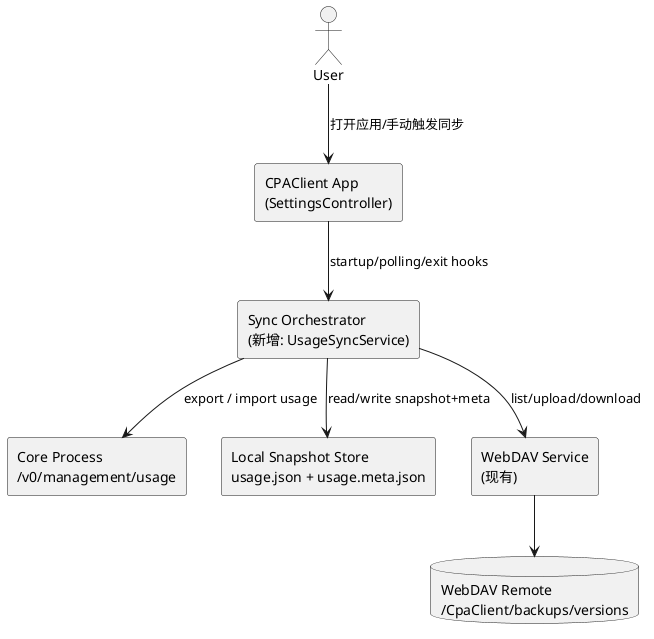
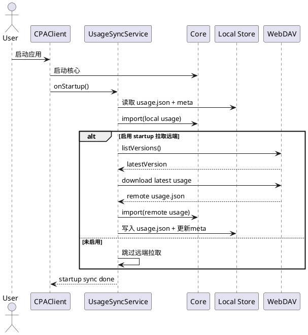
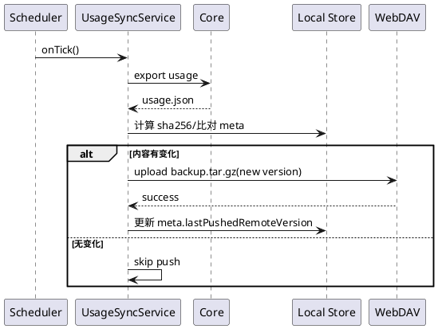

# Usage 多端 WebDAV 同步技术方案

## 1. 目标

在不改变核心管理接口（`/v0/management/usage/export|import`）的前提下，实现：

1. **核心重启不丢 usage 数据**（本地快照恢复）
2. **多端通过 WebDAV 同步 usage 数据**
3. 启动时可选“自动拉取远端最新并恢复”
4. 冲突可控、失败可回退、行为可观测

---

## 2. 现状（基于当前代码）

- 已有本地 usage 导出/导入链路（`SettingsController`）
  - 定时导出本地 usage 快照
  - 启动后延迟导入本地 usage
- WebDAV 已支持备份与恢复（`WebdavService`）
  - 备份包 `backup.tar.gz` 已包含 `usage.json`
  - 支持按版本恢复 usage
- 现状缺口：**启动时并不会自动拉取远端最新 usage**（仅导入本地）

---

## 3. 设计原则

- **本地优先可用**：无网时不影响启动
- **远端最终一致**：网络恢复后自动追平
- **最小侵入**：复用现有 WebDAV 版本目录与 usage import/export
- **可回滚**：每次同步保留版本快照

---

## 4. 总体架构



---

## 5. 远端与本地数据模型

### 5.1 本地

- `usage.json`：usage 快照（已存在）
- `usage.meta.json`（新增）

示例：

```json
{
  "deviceId": "win-01",
  "lastExportAt": "2026-03-10T10:00:00Z",
  "lastImportedRemoteVersion": "20260310T095800Z",
  "lastPushedRemoteVersion": "20260310T100000Z",
  "contentSha256": "..."
}
```

### 5.2 WebDAV 远端

继续复用现有版本目录：

- `backups/versions/<versionId>/backup.tar.gz`

其中 `backup.tar.gz` 内至少包含：
- `usage.json`
- `config.yaml`（现有能力保留）
- `auth-json/*.json`（现有能力保留）

> 不新增远端“中心索引”文件，避免并发写同一文件。

---

## 6. 同步策略

### 6.1 启动阶段

1. 启动核心
2. 导入本地 `usage.json`（现有逻辑）
3. 若开启“启动时拉取远端最新 usage”：
   - 读取远端最新版本
   - 比较本地 `contentSha256` / `lastImportedRemoteVersion`
   - 若远端更新，则下载并导入
4. 导入成功后更新 `usage.meta.json`

### 6.2 运行阶段（周期同步）

- 每 1 分钟导出本地 usage（现有）
- 每 N 分钟（建议默认 5）执行一次“远端推送检查”
  - 若本地哈希变化，则上传新版本（新 `versionId`）
  - 更新 `lastPushedRemoteVersion`

### 6.3 退出阶段

- 退出前执行一次强制导出+推送（best effort）

---

## 7. 冲突处理（多端并发）

采用 **LWW（Last Write Wins）+ 版本留存**：

- 以 `versionId`（UTC 时间）排序，最新版本优先
- 每次写入都产生新版本，不覆盖历史
- 冲突时不尝试字段级 merge，直接选择最新版本
- 用户可在 UI 中手动恢复旧版本（已有版本恢复能力）

---

## 8. 关键时序图

### 8.1 启动自动拉取远端最新 usage



### 8.2 周期推送到 WebDAV



---

## 9. 配置项建议（新增）

- `usageSyncEnabled`（bool，默认 true）
- `usageSyncOnStartupPullLatest`（bool，默认 false）
- `usageSyncPushIntervalMinutes`（int，默认 5）
- `usageSyncOnExitPush`（bool，默认 true）

---

## 10. 失败与重试

- WebDAV 拉取失败：记录日志，不阻塞启动
- usage 导入失败：按现有重试机制（最多 8 次）
- WebDAV 推送失败：指数退避重试（建议 3 次）
- 任一失败都不清空本地快照

---

## 11. 安全与一致性

- 继续使用现有 WebUI 密钥链路进行 usage import/export
- WebDAV 凭据沿用当前加密存储
- 不在日志打印 usage 明文内容
- 仅记录版本号、哈希、耗时、错误摘要

---

## 12. 实施分期

### Phase 1（最小可用）
- 新增 `usage.meta.json`
- 启动可选拉取远端最新 usage
- 周期推送（哈希变化才上传）

### Phase 2（增强）
- UI 增加“同步状态”面板（最后同步时间、最近版本、失败原因）
- 手动“立即拉取最新”按钮

### Phase 3（优化）
- 失败告警与诊断包导出
- 可选策略：仅 Wi-Fi/仅空闲同步

---

## 13. 验收标准

1. 单机：重启核心后 usage 不丢失
2. 双机 A/B：A 产生新 usage，B 在启动或轮询后可拉到最新
3. WebDAV 不可用：应用仍可启动，恢复本地 usage
4. 并发写入：远端保留多个版本，可回退
5. 日志可观测：可追踪每次 pull/push 成败与版本号

---

## 14. Implementation Checklist（按文件拆解）

> 目标：按最小改动落地 Phase 1（可用版本），再逐步增强。

### 14.1 数据模型与配置项

- [ ] `lib/core/models/app_settings.dart`
  - [ ] 新增字段：
    - `usageSyncEnabled`（bool）
    - `usageSyncOnStartupPullLatest`（bool）
    - `usageSyncPushIntervalMinutes`（int）
    - `usageSyncOnExitPush`（bool）
  - [ ] 在 `defaults()` 增加默认值
  - [ ] 更新 `copyWith` / `toJson` / `fromJson`
  - [ ] 在 `fromJson` 做兜底与区间归一化（如最小 1 分钟）

- [ ] `lib/core/services/app_settings_service.dart`
  - [ ] 加密 schema payload 写入上述字段
  - [ ] `_loadEncrypted` 两条路径都读取字段
  - [ ] 缺失字段时回退 defaults，确保兼容旧配置

### 14.2 新增 usage 同步编排服务

- [ ] 新建 `lib/core/services/usage_sync_service.dart`
  - [ ] 定义 `UsageSyncService`：封装 startup pull / periodic push / exit push
  - [ ] 依赖注入：
    - `WebdavService`
    - `SandboxPathService`
    - `SandboxConfigService`
    - `UsageNetworkService`（或复用 controller 现有 export/import）
    - `ManagementAccessService`
    - `AppLogService`
  - [ ] 能力方法：
    - [ ] `Future<void> syncOnStartup(AppSettings settings)`
    - [ ] `Future<void> syncOnInterval(AppSettings settings)`
    - [ ] `Future<void> syncOnExit(AppSettings settings)`
    - [ ] `Future<void> pullLatestIfNeeded(AppSettings settings, {required String trigger})`
    - [ ] `Future<void> pushIfChanged(AppSettings settings, {required String trigger})`

- [ ] 新建 `lib/core/models/usage_sync_meta.dart`
  - [ ] 字段：
    - `deviceId`
    - `lastExportAt`
    - `lastImportedRemoteVersion`
    - `lastPushedRemoteVersion`
    - `contentSha256`
  - [ ] `toJson/fromJson`

- [ ] 新建 `lib/core/services/usage_sync_meta_store.dart`
  - [ ] 读写 `usage.meta.json`
  - [ ] 文件不存在时返回默认对象
  - [ ] 写入采用原子替换（临时文件 + rename）

### 14.3 WebDAV 接口复用与补充

- [ ] `lib/core/services/webdav_service.dart`
  - [ ] 复用现有 `listVersions` / `restoreUsage` / `backup`
  - [ ] （可选）新增更轻量方法：
    - [ ] `Future<String?> getLatestVersionId(...)`
    - [ ] `Future<bool> downloadUsageFromVersion(...)`
    - [ ] `Future<String> uploadUsageAsNewVersion(...)`
  - [ ] 统一日志字段：`trigger`、`versionId`、耗时、结果

### 14.4 启动流程接入

- [ ] `lib/features/settings/settings_controller.dart`
  - [ ] 在 `load()` 中：
    - [ ] 保留现有本地导入（`_importLocalUsageAfterDelay`）
    - [ ] 在其后接入 `UsageSyncService.syncOnStartup(settings)`
  - [ ] 新增定时器（或复用现有 timer）触发 `syncOnInterval`
  - [ ] 在 `disposeController()` 前触发 `syncOnExit`（best effort）
  - [ ] 防重入：startup sync / interval sync / exit sync 三类锁

### 14.5 设置页开关（可选但建议）

- [ ] `lib/features/settings/settings_controller.dart`
  - [ ] 增加保存方法：
    - [ ] `saveUsageSyncEnabled(bool)`
    - [ ] `saveUsageSyncOnStartupPullLatest(bool)`
    - [ ] `saveUsageSyncPushIntervalMinutes(int)`
    - [ ] `saveUsageSyncOnExitPush(bool)`

- [ ] `lib/features/settings/settings_page.dart`
  - [ ] 在 WebDAV/Preferences 区增加开关与间隔下拉
  - [ ] 增加“立即拉取最新 usage”按钮（调用 `pullLatestIfNeeded`）
  - [ ] 增加“立即推送 usage”按钮（调用 `pushIfChanged`）

### 14.6 AppServices 装配

- [ ] `lib/core/services/app_services.dart`
  - [ ] 注册 `UsageSyncService` 与 meta store
  - [ ] 暴露 `AppServices.usageSync`

### 14.7 日志与可观测性

- [ ] 统一日志前缀：`UsageSync` / `UsagePull` / `UsagePush`
- [ ] 关键日志点：
  - [ ] 触发来源（startup/timer/exit/manual）
  - [ ] 本地 hash
  - [ ] 远端 versionId
  - [ ] 结果（success/skip/fail）

### 14.8 测试与验证

- [ ] 单元测试（建议新增）：
  - [ ] `test/core/services/usage_sync_meta_store_test.dart`
  - [ ] `test/core/services/usage_sync_service_test.dart`
- [ ] 集成验证：
  - [ ] 启动拉取开关打开时，能拉取远端最新
  - [ ] 本地未变更时不重复推送
  - [ ] WebDAV 异常不阻塞应用启动
  - [ ] 退出时 best effort 推送，不影响退出流程

### 14.9 里程碑建议

- [ ] M1：仅代码接入（无 UI），通过配置启用
- [ ] M2：补 UI 开关与手动触发按钮
- [ ] M3：补状态展示（最后同步时间、最后错误）
